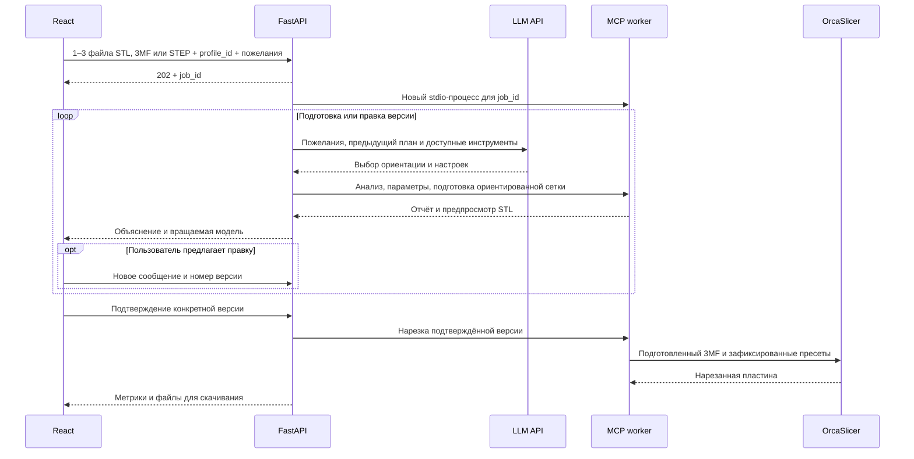

# AI-SLICE. Подготовка 3D-моделей к FDM-печати

## Локальный запуск на Windows

Установите OrcaSlicer на машину, где выполняется MCP. Для сквозной проверки использовалась версия 2.5.2. Участники команды скачивают установщик отдельно, а репозиторий хранит код, шаблон конфигурации и проверенные профили. [Официальный выпуск OrcaSlicer 2.5.2](https://github.com/OrcaSlicer/OrcaSlicer/releases/tag/v2.5.2)

При пустом `ORCA_SLICER_BIN` MCP ищет OrcaSlicer в `PATH`, затем в стандартных каталогах Program Files на Windows. Для portable-сборки или нестандартной установки задайте абсолютный путь к исполняемому файлу в локальном `src/.env`. При нескольких установках этот параметр позволяет выбрать нужную версию.

### 1. Подготовьте проект при первом запуске

Выполните команды из корня репозитория. Если зависимости уже установлены, переходите к запуску серверов.

```powershell
python -m venv src/.venv
.\src\.venv\Scripts\python.exe -m pip install -r src/backend/requirements.txt
if (!(Test-Path src/.env)) { Copy-Item src/.env.example src/.env }
npm.cmd --prefix src/frontend ci
```

Проверьте, что в `src/.env` стоит `LLM_MODE=local`. Ключ API в этом режиме не нужен. Готовый каталог профилей находится в `src/profiles`. Для собственных профилей укажите каталог в `PROFILES_ROOT`. Относительные пути в конфигурации отсчитываются от `src`.

### 2. Запустите бэкенд и фронтенд

В первом терминале из корня проекта запустите бэкенд и оставьте терминал открытым.

```powershell
.\src\backend_start.bat
```

Бэкенд слушает порт `8000`. Во втором терминале из корня проекта запустите фронтенд.

```powershell
.\src\frontend_start.bat
```

Откройте адрес, который покажет Vite, обычно `http://localhost:5173`. Vite перенаправляет запросы `/api` на порт `8000`.

### 3. Проверьте нарезку

1. Выберите профиль принтера и материал, загрузите от одного до трёх готовых файлов STL, 3MF или STEP.
2. Напишите пожелание, например «сделай фигурку крепче», и нажмите **«Подготовить модель»**.
3. Проверьте план и 3D-предпросмотр. Нажмите **«Подтвердить и нарезать»**.
4. Когда нарезка завершится, скачайте `.gcode` или `.gcode.3mf`.

Если вы меняли `ORCA_SLICER_BIN` в `src/.env`, перезапустите бэкенд.

### Режимы работы

`LLM_MODE=local` запускает весь конвейер через MCP и выбирает вариант детерминированно по геометрии и каталогу. Распознаются запросы на прочность, детализацию, скорость, заполнение в процентах, поддержки и ось нагрузки. Для свободного диалога включите режим API.
В режиме `LLM_MODE=api` откройте локальный `src/.env` и заполните `LLM_BASE_URL`, `LLM_API_KEY` и `LLM_MODEL` по документации выбранного провайдера. Нужен OpenAI-совместимый API Chat Completions, а выбранная модель и тариф должны поддерживать вызов функций (tool calling). В базовом URL укажите часть адреса до `chat/completions`. Параметр `LLM_TOOL_CHOICE=auto` оставляет модели выбор из одного инструмента на этапе, а приложение проверяет его имя и аргументы. Если провайдер поддерживает принудительный вызов функции по имени, можно поставить `LLM_TOOL_CHOICE=named`. Перезапустите бэкенд после изменения `src/.env`. Храните ключ в локальном файле.

Trimesh читает и проверяет сетку. Для измерений лучами можно установить `libigl==2.6.3` в ту же среду. При отсутствии библиотеки используется пересечение луча с треугольниками на NumPy. [Python API libigl](https://libigl.github.io/libigl-python-bindings/api/igl/#ray_mesh_intersect)

## Архитектура



FastAPI управляет этапами подготовки и запуском нарезки после подтверждения. В режиме API он публикует схему текущего MCP-инструмента как функцию провайдера, добавляет `job_id` локально и возвращает LLM JSON с краткими метриками. Данные вершин, файлы моделей, пресеты и пути хранилища остаются на машине с OrcaSlicer. MCP работает через `stdio` в отдельном процессе для каждой задачи. В этом локальном MVP одновременно выполняется одна задача. При перезапуске прерванная задача получает `INTERRUPTED`.

### Хранилище

```text
jobs/<uuid>/
  source.stl, source-2.stl, source-3.stl  # сетки для анализа
  source.3mf, source-2.step               # примеры исходников CAD или 3MF
  status.json                # текущая версия, история, отчёт и статус
  rev-1/                     # каждая версия хранится отдельно
    geometry.json
    orientations.json
    project.json
    profile/                 # снимок пресетов конкретной версии
    plate.3mf                # геометрия для OrcaSlicer
    preview.stl              # та же ориентация для WebGL
    orca-data/               # появляется после запуска OrcaSlicer
    orca.log
    result.json
    output/
      result.gcode.3mf
      result.gcode
```

### API

| Метод и путь | Вход и результат |
| --- | --- |
| `GET /api/health` | Проверка доступности FastAPI |
| `GET /api/profiles` | Допущенные сочетания принтеров и материалов, варианты процесса |
| `POST /api/jobs` | Multipart с 1–3 полями `model` (STL, 3MF, STEP или STP, 16 МиБ на файл), `profile_id`, `prompt` (до 4 000 символов). HTTP 202 с UUID и начальным статусом |
| `GET /api/jobs/{job_id}` | Текущий статус, этап, итог или `error: {code, message}` |
| `WS /api/jobs/{job_id}/events` | Снимок при подключении, затем изменившиеся статусы до завершения подготовки. React использует REST-опрос |
| `GET /api/jobs/{job_id}/preview/{revision}.stl` | Предпросмотр версии в координатах стола |
| `POST /api/jobs/{job_id}/revise` | JSON с `revision`, `prompt` и необязательным `profile_id`. Создаёт следующую версию на основе тех же загруженных моделей |
| `POST /api/jobs/{job_id}/approve` | JSON с `revision`. Переводит `review` в `slicing`. Файлы появляются в статусе `approved` |
| `GET /api/jobs/{job_id}/artifacts/{name}` | Потоковая выдача одного из двух файлов после подтверждения |

Статусы подготовки идут от `queued` через `running` к `review`. Правка запускает подготовку следующей версии. Подтверждение актуальной версии запускает `slicing`, после успеха статус становится `approved`. Ошибка подготовки переводит задачу в `failed`. При ошибке нарезки показан прежний план с возможностью повторить запрос. HTTP 415 означает неподдерживаемый формат, 413 — превышение 16 МиБ, 422 — ошибку параметров загрузки или профиля, 404 — неизвестную задачу или артефакт, 409 — недопустимый переход состояния. Ошибки фоновой нарезки доступны в статусе задачи, например `INVALID_STL`, `INVALID_MESH`, `DOES_NOT_FIT`, `PLATE_LAYOUT_NOT_FOUND`, `SUPPORT_REQUIRED`, `LLM_TOOL_CALL`, `ORCA_TIMEOUT`, `ORCA_FAILED`, `ORCA_INVALID_PLATE` и `ORCA_NO_RESULT`.

### MCP tools

Все инструменты принимают `job_id: UUID`. Доменные ошибки имеют форму `{"error":{"code":"...","message":"..."}}`. Результаты передаются как структурированный JSON MCP.

| Инструмент | Дополнительный вход | Выход |
| --- | --- | --- |
| `inspect_model` | — | Число граней, габариты, центр масс, объём и оценка толщины по всей поверхности. Для партии — массив `models` с отчётом по каждой сетке и сводка по стенкам |
| `analyze_orientations` | `load_model_xyz: number[3]`, по умолчанию `[0,0,0]` и `priority` (`balanced`, `stability`, `min-support`) | `orientations` с ID, площадью контакта и нависаний. Для партии — проверенная раскладка с поворотами, координатами и оценками по каждой детали |
| `set_parameters` | `orientation_id: string`, `variant_id: string`, `rationale: string` до 1 000 символов | `printer`, `material`, `variant`, `orientation` с матрицей `model_to_plate: number[4][4]`, `load_model_xyz`, `rationale` |
| `preview_model` | — | Записывает ориентированные 3MF и STL, возвращает `risks: string[]` и `bridge` |
| `slice_model` | — | После подтверждения возвращает `metrics` с `estimated_seconds`, `filament_g`, `filament_mm` (число или `null`) |

### Координаты и геометрия

- STL интерпретируется в миллиметрах. Геометрия 3MF и STEP/STP перед анализом преобразуется во внутреннюю сетку в миллиметрах. Для чтения 3MF используется OrcaSlicer, для STEP — Open Cascade (OCP). Параметры нарезки выбираются из каталога проекта. Каждый входной файл должен представлять одну замкнутую связную деталь. Лимит — 250 000 граней на деталь. Он удаляет дубликаты и вырожденные грани и исправляет полностью обращённую ориентацию граней. Условия пригодности для MVP включают положительный объём, попадание в рабочую область, контакт со столом и доступность поддержек.
- Кандидаты берутся из шести направлений вдоль осей и нормалей граней, сгруппированных по направлению и площади. Учитывается, остаётся ли проекция центра масс над опорным контуром, сколько поверхности нависает и как далеко она находится от стола. Матрица задаёт `p_plate = R @ p_model + t`. По Z нижняя точка переводится на `Z=0`, а позицию по XY определяет раскладка. Вектор нагрузки преобразуется как `R @ v_model`, без переноса.
- Контакт измеряется по граням в плоскости стола. Толщина оценивается лучами внутрь поверхности из центра каждой грани и дополнительных точек на крупных гранях. Начальный шаг дополнительных проб равен половине порога профиля. Для больших сеток шаг может увеличиваться, а проверка каждой грани сохраняется. В отчёте указано число граней с успешным измерением. Очень локальное утончение между пробами может быть пропущено. Кандидаты в мосты — выборочные горизонтальные участки над столом с двумя встречными пересечениями по X или Y чуть ниже поверхности. Эти оценки эвристические. Они пропускают отдельные участки, не выявляют все самопересечения и не рассчитывают механическую прочность. Orca формирует фактические траектории и древовидные поддержки.
- На этапе предпросмотра к исходной сетке применяется сохранённая матрица. Геометрия сохраняется в 3MF в миллиметрах и как STL для Three.js. До подтверждения пользователь может вращать и приближать деталь на сетке стола. Траектории и геометрия поддержек рассчитываются во время нарезки. `--orient 0 --arrange 0` отключают повторное ориентирование и раскладку. Запуск через `subprocess.run` ограничен 300 секундами и проверяет код завершения. После экспорта проверяется, что архив содержит один непустой G-code. Время и расход читаются из его комментариев. [OrcaSlicer CLI](https://github.com/OrcaSlicer/OrcaSlicer/wiki/cli_mode)

### Несколько деталей на одной пластине

В форме загрузки можно выбрать до трёх файлов моделей одновременно. Для всей пластины используется одна пара принтер–материал и один вариант процесса. Для каждой детали MCP отдельно выбирает опорную грань. Затем раскладчик пробует довороты вокруг Z с шагом 15° и смещения. Он проверяет расстояния между полными XY-проекциями сеток, включая впадины, и границы рабочей области профиля. Прямоугольные габариты соседних деталей могут перекрываться. Минимальный зазор между контурами составляет 2 мм; для деталей с нависаниями предусмотрен дополнительный запас.

Раскладка ищется эвристически с ограничением времени. Если допустимый вариант не найден, интерфейс возвращает ошибку `PLATE_LAYOUT_NOT_FOUND`. LLM выбирает приоритет, а координаты и зазоры проверяет геометрический алгоритм. Объём поддержек для выбора позы оценивается приближённо. Фактические поддержки, юбки и другие траектории формирует OrcaSlicer после подтверждения.

Предпросмотр показывает всю пластину в общих координатах. В 3MF каждая деталь записывается отдельным объектом. OrcaSlicer получает эту раскладку с отключённым автоматическим размещением и нарезает всю партию по слоям. Перед выдачей файла проверяются число нарезанных объектов, границы первого слоя и отсутствие отметки OrcaSlicer о выходе за пластину.

### Профили

В комплекте есть принтеры Bambu Lab, Creality, Prusa, Anycubic и Elegoo с соплом 0,4 мм, совместимые варианты PLA, PETG, ABS, ASA, TPU, PC и PA, а также планы для баланса, прочности, детализации и скорости с настройками поддержек. Каталог получен из исходных пресетов OrcaSlicer 2.5.2. См. [происхождение и обновление каталога](profiles/README.md).

В собственной директории профиля храните `profile.json` и экспортированные JSON OrcaSlicer. Допустимы и отдельные `profile-<material>.json` с общими файлами принтера и процесса. Ниже пример манифеста.

```json
{
  "printer": "FFF 0.4 mm",
  "material": "PLA",
  "machine": "machine.json",
  "filament": "filament.json",
  "bed_origin_mm": [0, 0],
  "bed_size_mm": [220, 220, 250],
  "margin_mm": 5,
  "overhang_deg_from_vertical": 45,
  "min_wall_mm": 0.8,
  "max_bridge_mm": 15,
  "variants": [
    {"id": "balanced", "process": "balanced.json", "priority": "balanced", "infill_pct": 15, "supports": "none"},
    {"id": "strength-tree", "process": "strength-tree.json", "priority": "strength", "infill_pct": 35, "supports": "tree"}
  ]
}
```

Пресеты должны содержать явные значения, `type` (`machine`, `filament` или `process`), `from` (`User`, `user` или `system`) и иметь разрешённое наследование в самом JSON (пустой либо отсутствующий `inherits`). Поле `material` сверяется с `filament_type`. Для печатного процесса проверяются `sparse_infill_density`, `enable_support` и для дерева `support_type = tree(auto)` и `support_threshold_angle = 90 - overhang_deg_from_vertical`. Температуры, скорости, размеры ветвей и другие параметры поступают из проверенного пресета. Вариант с выключенными поддержками отклоняется, если выбранная поза имеет нависания. Для PETG и ABS добавляются отдельные каталожные записи. [Параметры поддержек OrcaSlicer](https://github.com/OrcaSlicer/OrcaSlicer/wiki/support_settings_support)

### Границы реализации

Код рассчитан на однопользовательский локальный запуск. При вынесении вычислений на другой хост сохраняется API для React, а MCP переносится на приватный Streamable HTTP и получает доступ к тому же хранилищу или к объектам по временным ссылкам. Для многопользовательского запуска нужны привязка задач к владельцам, очередь с восстановлением и лимиты хранения и вычислений.
