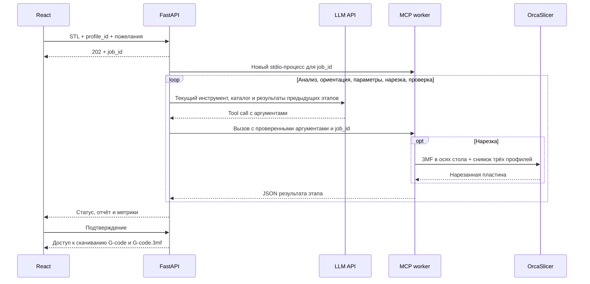

# AI-SLICE. Подготовка STL к FDM-печати

## Запуск на Windows

Из корня репозитория. Для установки зависимостей можно использовать отдельную среду `src/.venv`. OrcaSlicer 2.5.2 использовался для сквозной проверки.

```powershell
python -m venv src/.venv
.\src\.venv\Scripts\python.exe -m pip install -r src/backend/requirements.txt
Copy-Item src/.env.example src/.env
npm.cmd --prefix src/frontend ci
```

Заполните `src/.env` и добавьте хотя бы один проверенный профиль в `src/profiles`. Относительные пути в конфигурации отсчитываются от `src`. В первом терминале запустите API из `src/backend`.

```powershell
Set-Location src/backend
..\.venv\Scripts\python.exe -B -m uvicorn main:app --host 127.0.0.1 --port 8000 --loop asyncio
```

Во втором терминале, из корня репозитория, запустите `npm.cmd --prefix src/frontend run dev` и откройте адрес Vite. Vite проксирует `/api` на порт 8000. Альтернативно можно использовать `src/backend_start.bat` и `src/frontend_start.bat`. Скрипт API ищет интерпретатор в `src/.venv` и `src/venv`.

`LLM_MODE=local` запускает весь конвейер через MCP и выбирает вариант детерминированно по геометрии и каталогу. Текст пожеланий сохраняется в задаче. В режиме `LLM_MODE=api` укажите `LLM_BASE_URL`, `LLM_API_KEY` и `LLM_MODEL`. Для Yandex AI Studio базовый URL указан в примере, в `LLM_MODEL` нужен URI модели вашего каталога. Адаптер использует Chat Completions с вызовом конкретной функции по имени и требует поддержки этого режима выбранной моделью. [Yandex AI Studio и вызовы функций](https://yandex.cloud/ru/docs/monium/traces/llm/auto_instrumentation)

Trimesh читает и проверяет сетку. Для измерений лучами можно установить `libigl==2.6.3` в ту же среду. При отсутствии библиотеки используется пересечение луча с треугольниками на NumPy. [Python API libigl](https://libigl.github.io/libigl-python-bindings/api/igl/#ray_mesh_intersect)

## Архитектура



FastAPI управляет порядком пяти этапов. В режиме API он публикует схему текущего MCP-инструмента как функцию провайдера, добавляет `job_id` локально и возвращает LLM JSON с краткими метриками. Данные вершин, файлы моделей, пресеты и пути хранилища остаются на машине с OrcaSlicer. MCP работает через `stdio` в отдельном процессе для каждой задачи. В этом локальном MVP одновременно выполняется одна задача. При перезапуске прерванная задача получает `INTERRUPTED`.

### Хранилище

```text
jobs/<uuid>/
  source.stl                 # входной файл под серверным именем
  status.json                # статус, пожелания, итоговый отчёт или ошибка
  geometry.json              # свойства исходной сетки
  orientations.json          # допустимые матрицы и метрики поз
  project.json               # выбранная поза, материал и процесс
  profile/                   # снимок профилей на момент загрузки
    profile.json
    machine.json
    filament.json
    process-<variant>.json
  plate.3mf                  # сетка в координатах стола
  orca-data/                 # рабочие данные экземпляра Orca
  orca.log                   # stdout и stderr процесса
  result.json                # метрики и признаки мостов
  output/
    result.gcode.3mf
    result.gcode
```

### API

| Метод и путь | Вход и результат |
| --- | --- |
| `GET /api/health` | Проверка доступности FastAPI |
| `GET /api/profiles` | Допущенные сочетания принтеров и материалов, варианты процесса |
| `POST /api/jobs` | Multipart `model` (STL), `profile_id`, `prompt` (до 4 000 символов). HTTP 202 с UUID и начальным статусом |
| `GET /api/jobs/{job_id}` | Текущий статус, этап, итог или `error: {code, message}` |
| `WS /api/jobs/{job_id}/events` | Снимок при подключении, затем изменившиеся статусы до завершения подготовки. React использует REST-опрос |
| `POST /api/jobs/{job_id}/approve` | Переводит `review` в `approved` и публикует список файлов. Повторное подтверждение возвращает тот же результат |
| `GET /api/jobs/{job_id}/artifacts/{name}` | Потоковая выдача одного из двух файлов после подтверждения |

Статусы подготовки идут от `queued` через `running` к `review`, затем к `approved` после действия пользователя. Ошибка переводит задачу в `failed`. HTTP 415 означает неподдерживаемый формат, 413 — превышение 16 МиБ, 422 — ошибку параметров загрузки или профиля, 404 — неизвестную задачу или артефакт, 409 — недопустимый переход состояния. Ошибки фоновой нарезки доступны в статусе задачи, например `INVALID_STL`, `INVALID_MESH`, `DOES_NOT_FIT`, `SUPPORT_REQUIRED`, `LLM_TOOL_CALL`, `ORCA_TIMEOUT`, `ORCA_FAILED` и `ORCA_NO_RESULT`.

### MCP tools

Все инструменты принимают `job_id: UUID`. Доменные ошибки имеют форму `{"error":{"code":"...","message":"..."}}`. Результаты передаются как структурированный JSON MCP.

| Инструмент | Дополнительный вход | Выход |
| --- | --- | --- |
| `inspect_model` | — | `faces: int`, `bounds_model_mm: number[2][3]`, `center_of_mass_model_mm: number[3]`, `volume_mm3: number`, `wall_samples: int`, `min_sampled_wall_mm: number \| null`, `thin_wall_samples: int` |
| `analyze_orientations` | `load_model_xyz: number[3]`, по умолчанию `[0,0,0]` | `orientations` с ID, габаритами, контактом и нависаниями в мм², центром масс на столе в мм, компонентой нагрузки поперёк слоёв, оценкой и выборочной статистикой мостов |
| `set_parameters` | `orientation_id: string`, `variant_id: string`, `rationale: string` до 1 000 символов | `printer`, `material`, `variant`, `orientation` с матрицей `model_to_plate: number[4][4]`, `load_model_xyz`, `rationale` |
| `slice_model` | — | `metrics` с `estimated_seconds`, `filament_g`, `filament_mm` (число или `null`) и `bridge` с количеством проб и максимальным измеренным пролётом |
| `check_result` | — | Те же метрики и `risks: string[]` |

### Координаты и геометрия

- STL интерпретируется в миллиметрах. Анализ допускает одну замкнутую связную оболочку до 250 000 граней. Он удаляет дубликаты и вырожденные грани и исправляет полностью обращённую ориентацию граней. Условия пригодности для MVP включают положительный объём, попадание в рабочую область, контакт со столом и доступность поддержек.
- Проверяются шесть направлений нормали стола и два поворота вокруг Z. Матрица задаёт `p_plate = R @ p_model + t`. По XY центр габаритов ставится в центр области профиля, по Z нижняя точка переводится на `Z=0`. Вектор нагрузки преобразуется как `R @ v_model`, без переноса. Оценка учитывает долю контакта, долю нависаний и компоненту нагрузки поперёк слоёв.
- Контакт измеряется по граням в плоскости стола. Толщина оценивается лучами внутрь поверхности по выборке граней. Кандидаты в мосты — выборочные горизонтальные участки над столом с двумя встречными пересечениями по X или Y чуть ниже поверхности. Эти оценки эвристические. Они пропускают отдельные участки, не выявляют все самопересечения и не рассчитывают механическую прочность. Orca формирует фактические траектории и древовидные поддержки.
- Исполнитель применяет сохранённую матрицу к исходной сетке и записывает геометрию в 3MF с единицами `millimeter`. `--orient 0 --arrange 0` отключают повторное ориентирование и раскладку. Запуск через `subprocess.run` ограничен 300 секундами и проверяет код завершения. После экспорта проверяется, что архив содержит один непустой G-code. Время и расход читаются из его комментариев. [OrcaSlicer CLI](https://github.com/OrcaSlicer/OrcaSlicer/wiki/cli_mode)

### Профили

Одна директория, например `src/profiles/<printer>-pla/`, содержит `profile.json` и экспортированные JSON OrcaSlicer. Калибровку и допуск выполняет команда на целевом принтере. Ниже пример **манифеста**, размеры и значения следует взять из ваших проверенных профилей.

```json
{
  "printer": "FFF 0.4 mm",
  "material": "PLA",
  "machine": "machine.json",
  "filament": "filament.json",
  "bed_origin_mm": [0, 0],
  "bed_size_mm": [220, 220, 250],
  "margin_mm": 5,
  "overhang_deg_from_vertical": 45,
  "min_wall_mm": 0.8,
  "max_bridge_mm": 15,
  "variants": [
    {"id": "balanced", "process": "balanced.json", "priority": "balanced", "infill_pct": 15, "supports": "none"},
    {"id": "strength-tree", "process": "strength-tree.json", "priority": "strength", "infill_pct": 35, "supports": "tree"}
  ]
}
```

Пресеты должны содержать явные значения, `type` (`machine`, `filament` или `process`), `from` (`User`, `user` или `system`) и иметь разрешённое наследование в самом JSON (пустой либо отсутствующий `inherits`). Поле `material` сверяется с `filament_type`. Для печатного процесса проверяются `sparse_infill_density`, `enable_support` и для дерева `support_type = tree(auto)` и `support_threshold_angle = 90 - overhang_deg_from_vertical`. Температуры, скорости, размеры ветвей и другие параметры поступают из проверенного пресета. Вариант с выключенными поддержками отклоняется, если выбранная поза имеет нависания. Для PETG и ABS добавляются отдельные каталожные записи. [Параметры поддержек OrcaSlicer](https://github.com/OrcaSlicer/OrcaSlicer/wiki/support_settings_support)

### Границы реализации

Код рассчитан на однопользовательский локальный запуск. При вынесении вычислений на другой хост сохраняется API для React, а MCP переносится на приватный Streamable HTTP и получает доступ к тому же хранилищу или к объектам по временным ссылкам. Для многопользовательского запуска нужны привязка задач к владельцам, очередь с восстановлением и лимиты хранения и вычислений.

Новые входные форматы следует нормализовать до геометрического этапа. Для STEP нужен тесселятор с явной единицей измерения и допусками. Для 3MF нужен импорт сетки с учётом единиц, компонентов, матриц и лимитов архива. Геометрия нормализуется к одной сетке в миллиметрах, настройки печати берутся из серверного каталога. Текущая версия принимает одно сообщение на задачу. Итеративный диалог с ручными правками потребует версий `project.json` и повторной нарезки для каждой принятой версии.
